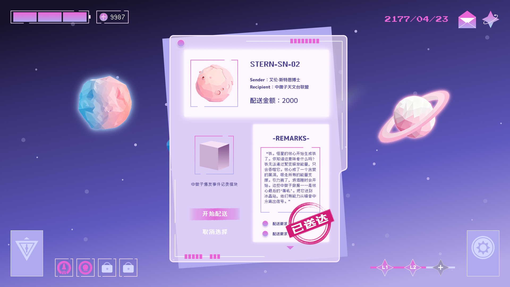
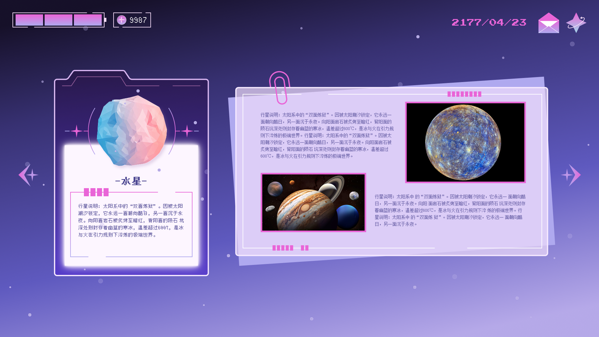

# Gravity Express | 订单派送中

**一款基于引力机制的太空物流策略解谜游戏**

《订单派送中》（Gravity Express）是一款以太空物流为主题的物理策略解谜游戏。玩家需要在复杂的星际环境中规划运输路线，利用星球引力、轨道预测与推进装置，完成不同条件下的货物配送任务。

游戏将物理运动规律转化为可交互的解谜机制，鼓励玩家在观察、预测与尝试中寻找最优运输方案。

## 核心玩法

- **引力与轨道运动**：利用不同天体的引力影响，规划飞船的运行轨迹。
- **轨道预测**：通过可视化轨迹辅助判断，提前规划运输路线。
- **策略升级**：通过推进器、隔热与防撞等能力升级，应对不同的运输挑战。
- **关卡挑战**：包含 13 个循序渐进的关卡，逐步引入新的机制与解谜目标。
- **多线叙事**：通过订单、邮件与图鉴系统，逐步探索游戏世界。

## 游戏系统

- 引力与轨道预测系统
- 飞船推进与运动控制系统
- 订单与任务管理系统
- 装备升级系统
- 邮件与图鉴收集系统
- 游戏进度存档系统

## 技术信息

| 项目 | 内容 |
|---|---|
| 游戏引擎 | Unity |
| 开发语言 | C# |
| 游戏类型 | 物理策略 / 太空解谜 |
| 运行平台 | Windows |
| 关卡数量 | 13 |

## 项目结构

- `Assets/`：游戏脚本、场景及美术资源
- `Packages/`：Unity 项目依赖
- `ProjectSettings/`：Unity 项目配置

## 游戏试玩

**Gravity Express v1.0 | Windows 试玩版**

《订单派送中》现已提供 Windows 游戏版本，可下载体验完整的星际配送与引力解谜玩法。

**[点击下载 Windows 游戏（v1.0）](https://github.com/Janze-17/Gravity-Express/releases/download/v1.0.0/Gravity-Express-Windows-v1.0.zip)**

### 运行说明

1. 下载 `Gravity-Express-Windows-v1.0.zip`。
2. 将 ZIP 文件完整解压至本地文件夹。
3. 双击 `SpaceArchitect.exe` 启动游戏。

**运行平台：** Windows

> 注意：请勿单独移动或删除游戏数据文件，确保 `.exe` 与相关文件夹保持在同一目录。

**Gravity Express | 订单派送中**

*预测轨道，穿越引力，完成每一次星际派送。*

## 游戏截图

  

01 / 初始界面 · MAIN MENU

<table>
  <tr>
    <td width="50%" align="center">
      
       02 / 订单送达 · DELIVERY
    </td>
    <td width="50%" align="center">
      
       03 / 订单完成 · COMPLETED
    </td>
  </tr>
  <tr>
    <td align="center">
      
       04 / 技能树 · SKILL TREE
    </td>
    <td align="center">
      
       05 / 行星图鉴 · PLANET CODEX
    </td>
  </tr>
</table>

